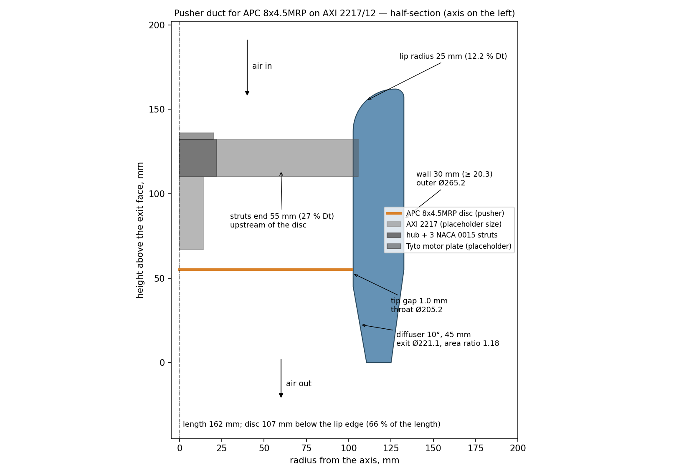

# Pusher duct for the APC 8x4.5MRP on the AXI 2217/12 (r27 tree)

A parametric duct designed to the rules in
[`docs/acoustic-speculations/duct-inlet-design-rules.pdf`](../../docs/acoustic-speculations/duct-inlet-design-rules.pdf).
The present r27 duct, unlined, gives −8.01 N at 2000 µs against −10.57 N for the bare
propeller (2026-11-02), so it costs thrust. This one is meant to add it. **Untested: nothing
here has been printed or run yet.**

**Pusher layout (2026-11-02, Adam's choice):** air enters through the lip, passes the Tyto motor
plate, the hub and three aerofoil struts and the motor, then the propeller, and leaves through the
diffuser. The motor hangs from the hub, shaft down to the propeller. It needs a pusher propeller
(APC 8x4.5MRP) or the motor reversed with the propeller flipped, and the stand will read thrust
with the opposite sign to a tractor set-up. The stand and its motor plate now sit in the inflow,
upstream of the lip.



| | value | rule it comes from |
|---|---|---|
| tip gap | 1.0 mm (throat Ø205.2) | 1: as small as can be built |
| inlet lip radius | 25 mm = 12.2 % D<sub>t</sub> | 2: 10–13 % D<sub>t</sub>, never under ~6 % |
| wall at the propeller plane | 30 mm (outer Ø265.2) | 3: ≥ 10 % of D = 20.3 mm |
| propeller disc | 107 mm below the lip edge, 66 % of the length | 4: well behind the lip; rearward is better static |
| diffuser | 10°, 45 mm, exit Ø221.1, exit/disc area 1.18 | 5: 10°, area ratio 1.1–1.3 |
| struts | 3 × NACA 0015, 22 mm chord, trailing edges 55 mm (27 % D<sub>t</sub>) upstream of the disc | 6: well clear of the rotor; odd count so the two blades never pass two struts at once |
| length | 162 mm | |

Upstream struts put their wakes into the propeller, which is why they sit as far forward of it
as the motor allows and have an aerofoil section. That reasoning is mine, not from the
extracts; the 5.5 % D<sub>t</sub> spacing rule in the PDF is the only sourced number for strut
placement.

## Files

The STLs are build output (the repo ignores `*.stl`); regenerate them after any change:

```bash
openscad -D 'part="quarter"' -o duct_quarter.stl duct.scad
openscad -D 'part="duct"'    -o duct_full.stl    duct.scad
openscad -D 'part="spider"'  -o spider.stl       duct.scad
../../.venv/bin/python render.py   # section.png, assembly.png
```

- `duct.scad` — the model; every number above is a parameter at the top. Changing
  `prop_to_mount` moves the hub and struts and lengthens or shortens the throat to suit.
- `duct_quarter.stl` — print **4×** (133 × 133 × 162 mm, exit face on the bed); 6 pin holes
  Ø3.2 per cut face for 3 mm pins or filament offcuts, then glue. Each strut root sits in a 3 mm
  pocket in the throat wall and is held by one M3 screw from outside (counterbored) into a
  heat-set insert in the strut root.
- `duct_full.stl` — the whole ring, for a bed of at least 270 mm.
- `spider.stl` — hub + 3 aerofoil struts (180 × 180 × 22 mm), prints flat on the motor-side face.
  The motor bolts to its downstream face and the Tyto motor plate to its upstream face, on the
  same long M3 bolts (stand plate → hub → motor).
- `viewer.html` — interactive 3D view in the browser (three.js from the CDN; built from the same
  numbers as `duct.scad`, so keep the two in step). Open it with `/snap/bin/brave viewer.html`.
- `render.py` — redraws `section.png` and `assembly.png` (OpenSCAD's own PNG export needs a display).

## Measure before printing

The motor dimensions in `duct.scad` are **placeholders, not verified data** (marked `[MEASURE]`):

- `prop_to_mount` (55 mm) — propeller disc to the motor's rear mounting face, with the prop adapter fitted;
- `mount_holes_n`, `mount_holes_pcd` (4 on Ø25) — the AXI 2217 rear-mount hole pattern, which the Tyto plate must share;
- `hub_hole_d` (12 mm) — clearance for whatever protrudes from the motor's rear;
- `blade_below` (10 mm) — straight throat below the disc; must cover the blade tips' axial extent.

Measure the real tip gap after assembly with a feeler gauge. A ring printed in four pieces will
not be round to 0.1 mm, so sand the throat until the tightest blade clears everywhere.

## Testing it

Same-day bare propeller and current unlined duct first, then this duct, then the bare propeller
again (§05 of the rules PDF). Repeats of one set-up agree within 0.1 N, so a difference above
~0.2 N is real. Compare per watt or at equal rpm as well as at equal ESC signal, and mind the
flipped thrust sign.
